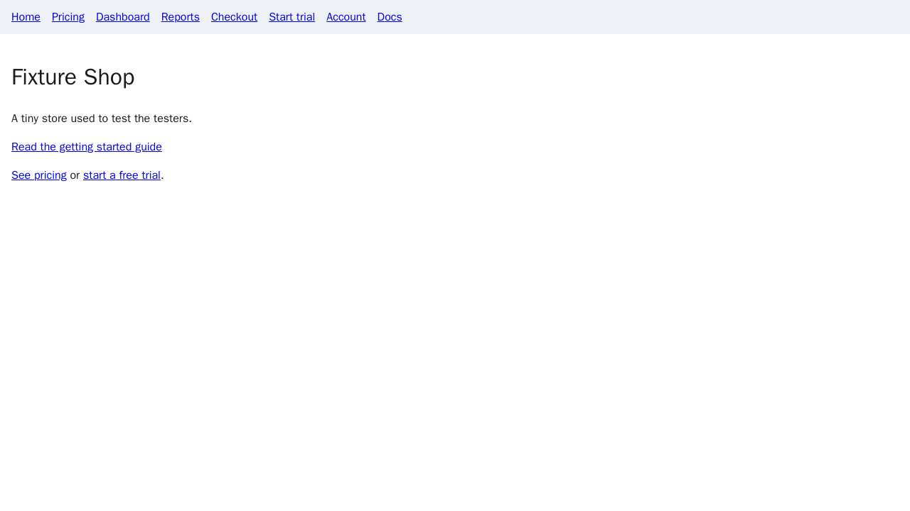
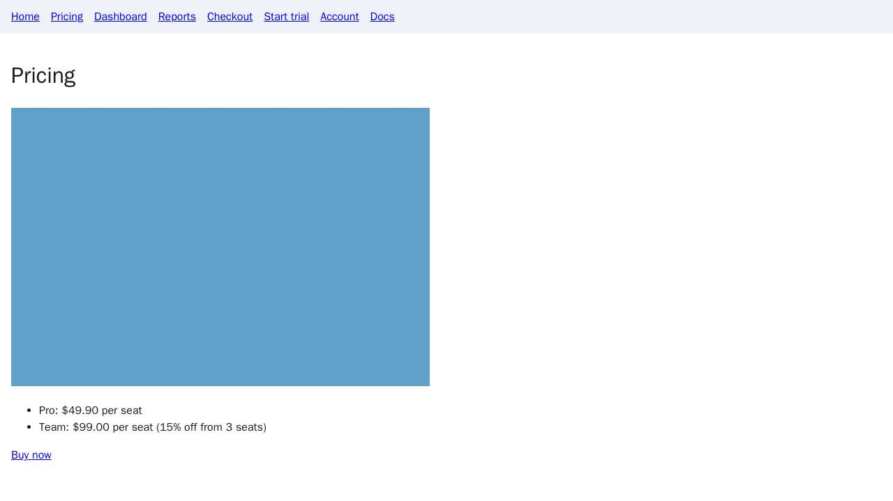
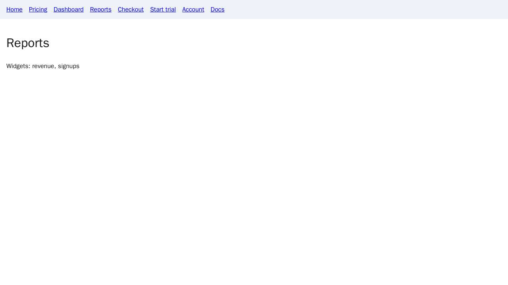
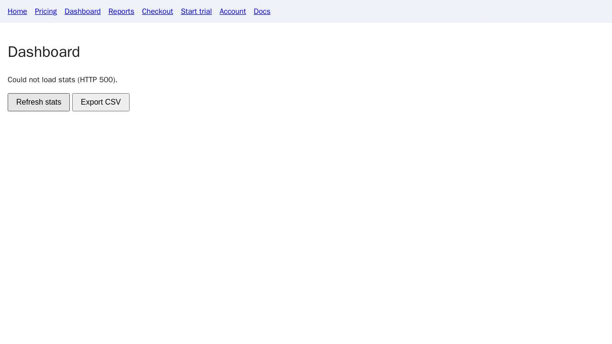

# Airlock QA report: katesaikishore/airlock-fixture-app@5880ef5

**Result:** FAILED (TESTS_FAILED) · **gate:** failed

| | |
| :--- | :--- |
| Run | `run_qa_5c2f33c545f64790` |
| Repository | https://github.com/katesaikishore/airlock-fixture-app |
| Commit | `5880ef5f0242ef050c46500f3dff50d67ccd7ffd` |
| Branch | `main` |
| Gate mode | strict |
| Started | 2026-11-08T09:41:55.519Z |
| Finished | 2026-11-08T09:42:29.640Z |
| Screenshots | 5 |

## Suites

| Suite | Result |
| :--- | :--- |
| smoke | PASS |
| explore | FAIL |

## Findings

| Severity | Finding | Route | Seen by |
| :--- | :--- | :--- | :--- |
| S2 | HTTP 500 from GET /api/stats ([screenshot](#screenshots)) `http_5xx` | `/dashboard` | Airlock checker |
| S2 | uncaught TypeError: Cannot read properties of undefined (reading 'run') ([screenshot](#screenshots)) `uncaught_exception` | `/dashboard` | Airlock checker |
| S3 | link to /docs/getting-started returns 404 ([screenshot](#screenshots)) `dead_link` | `/` | Airlock checker |
| S3 | session cookie without Secure ([screenshot](#screenshots)) `insecure_cookie` | `/` | Airlock checker |
| S3 | session cookie without SameSite ([screenshot](#screenshots)) `insecure_cookie` | `/` | Airlock checker |
| S3 | session cookie without HttpOnly ([screenshot](#screenshots)) `insecure_cookie` | `/` | Airlock checker |
| S3 | missing Strict-Transport-Security header ([screenshot](#screenshots)) `missing_security_header` | `/` | Airlock checker |
| S3 | missing Content-Security-Policy header ([screenshot](#screenshots)) `missing_security_header` | `/` | Airlock checker |
| S3 | console error: reports: failed to read widget config (config.widgets is undefined) ([screenshot](#screenshots)) `console_error` | `/reports` | Airlock checker |
| S4 | image without alt text ([screenshot](#screenshots)) `missing_alt` | `/pricing` | Airlock checker |
| S4 | oversized image /static/banner.bmp ([screenshot](#screenshots)) `oversized_asset` | `/pricing` | Airlock checker |

## Screenshots

### screenshot-1.jpg — / (finding on this page)

### screenshot-2.jpg — /pricing (finding on this page)

### screenshot-3.jpg — /reports (finding on this page)

### screenshot-4.jpg — /docs/getting-started (dead link: HTTP 404)

### screenshot-5.jpg — /dashboard (after clicking "Refresh stats")

## Reasons

- suite explore failed
- explore: checker visited 8 pages, clicked 3 controls, blocked 0 data-changing requests
- explore: S2 HTTP 500 from GET /api/stats (/dashboard)
- explore: S2 uncaught TypeError: Cannot read properties of undefined (reading 'run') (/dashboard)
- suite explore failed; explore: checker visited 8 pages, clicked 3 controls, blocked 0 data-changing requests; explore: S2 HTTP 500 from GET /api/stats (/dashboard); explore: S2 uncaught TypeError: Cannot read properties of undefined (reading 'run') (/dashboard)

## What this means

This report records what the run stored. A failed gate means the requested suites did not all pass; it is not a statement that the application is secure or compliant. Findings marked “Airlock checker” were seen by Airlock from its own container; findings marked “Your tests” come from the repository’s own test output and are self-reported.

The sealed result was verified with the service’s published Ed25519 key.

---

Generated by [AirlockQA](https://qbrin.cloud) for run `run_qa_5c2f33c545f64790`.
